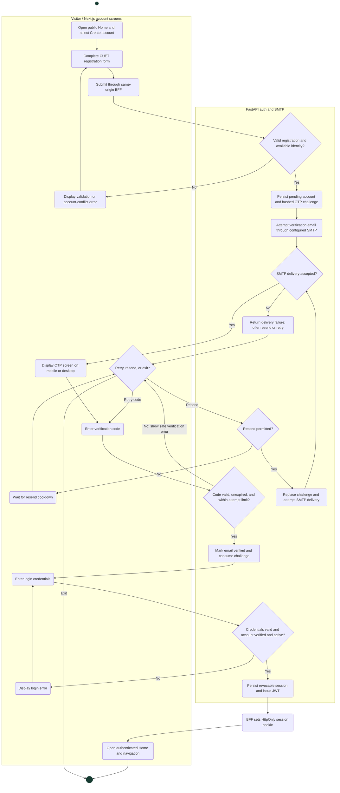
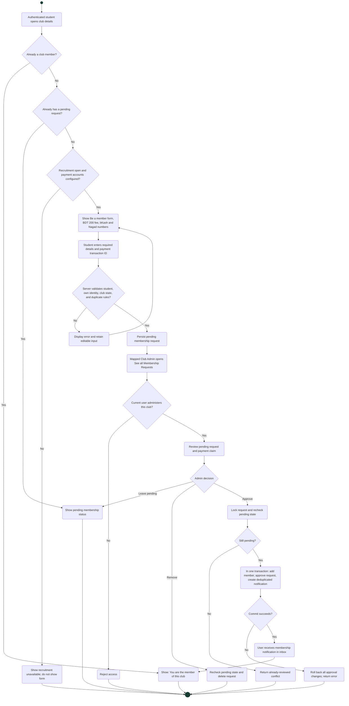
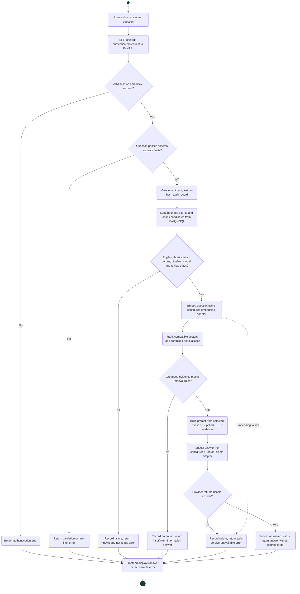

# UniCircle UML activity diagrams

Status: implementation-aligned reference, reviewed **2 November 2026**.

These activity views use GitHub-compatible Mermaid: filled circles are initial
nodes, double circles are activity finals, rounded rectangles are actions, and
diamonds are decisions or merges. Edge labels express guards. Subgraphs group
responsibilities; arrows express control flow, not network topology.

## 1. Registration, email verification, and login

Sign-up starts verification; successful login starts a session. A failed email
delivery must not be presented as successful verification. The backend enforces
CUET email policy, expiry, resend cooldown, attempt limits, and account uniqueness.
The browser receives an HttpOnly cookie rather than a JavaScript-readable JWT.
Password recovery is a separate flow: request email code → verify code → receive
a restricted reset grant → set a new password and revoke existing sessions → log
in again. See the [sequence diagrams](Sequence_Diagram.md) for recovery details.

Sources: [auth routes](../../backend/app/modules/auth/router.py),
[auth service](../../backend/app/modules/auth/service.py),
[email-code flows](../../backend/app/modules/auth/email_flows.py), and
[authentication frontend](../../frontend/src/features/auth).

## 2. Club membership recruitment and review

Only mapped admins can change recruitment settings or review requests for that
club. One student may administer several clubs, and a club may have several
admins. The standard membership fee is BDT 200. A submitted transaction ID is
a payment claim for manual review; there is no automatic bKash/Nagad payment
verification. Turning recruitment off blocks new submissions; existing pending
requests remain reviewable. Removal deletes a pending request; it is not an
approved-member removal operation. Concurrent review conflicts return errors.

Sources: [club routes](../../backend/app/modules/clubs/router.py),
[shared notifications](../../backend/app/core/notifications.py), and
[club frontend](../../frontend/src/features/clubs-events).

## 3. Campus assistant question and failure handling

Dashed flow denotes an exceptional embedding failure. Authentication precedes
retrieval. The chat model is not called for an empty/ineligible index or
insufficient evidence. Audit records contain question hashes and safeguard
metadata, not persisted chat transcripts. A refresh is an explicit operator
activity, separate from this request. Ingestion must finish before a matching
backend revision serves the changed corpus; changing repository files alone
does not refresh Neon vectors.

Sources: [assistant route](../../backend/app/modules/assistant/router.py),
[retrieval and generation](../../backend/app/modules/assistant/service.py),
[index eligibility](../../backend/app/modules/assistant/curated.py), and
[RAG source policy](RAG_Knowledge_Source_Policy.md).
