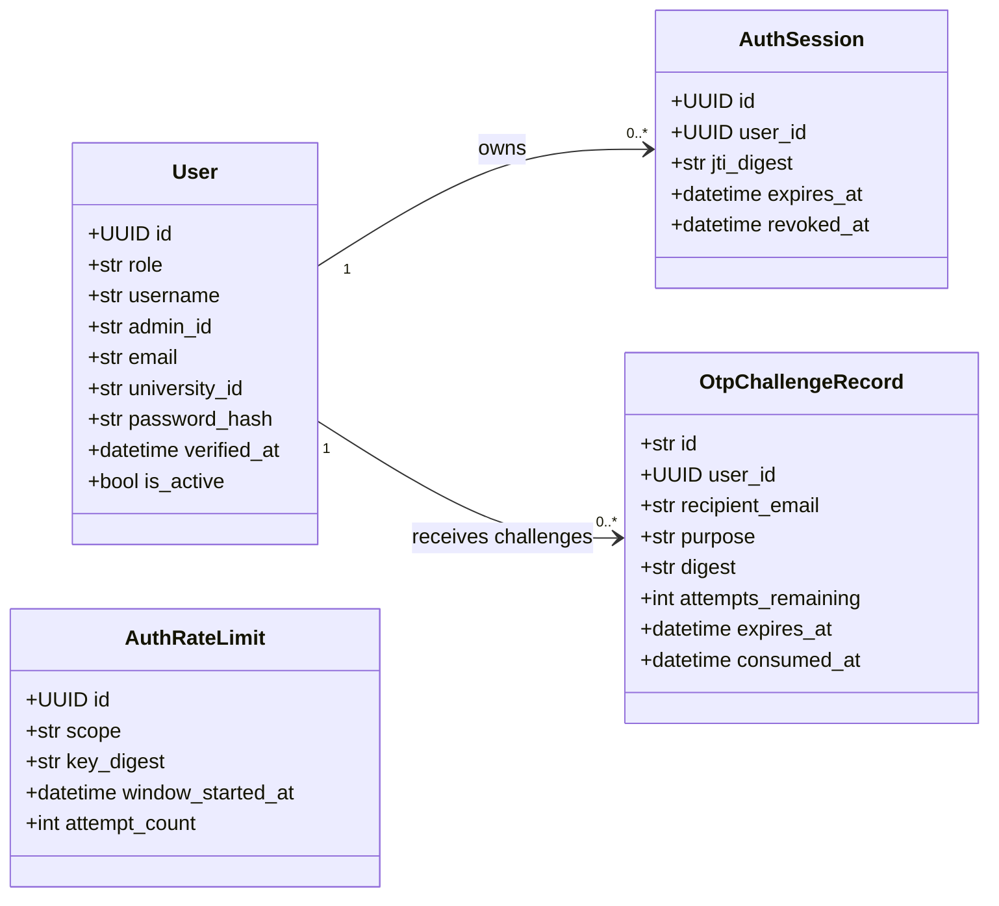
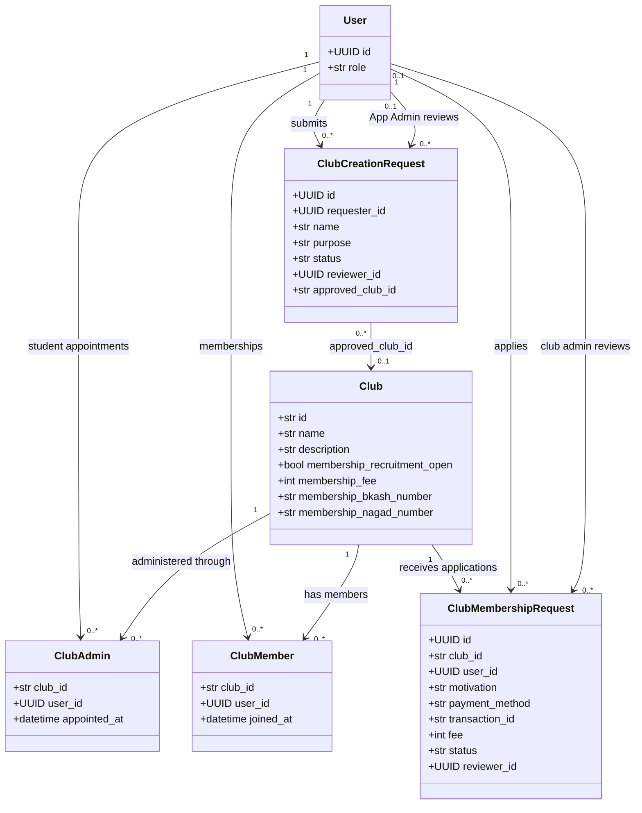
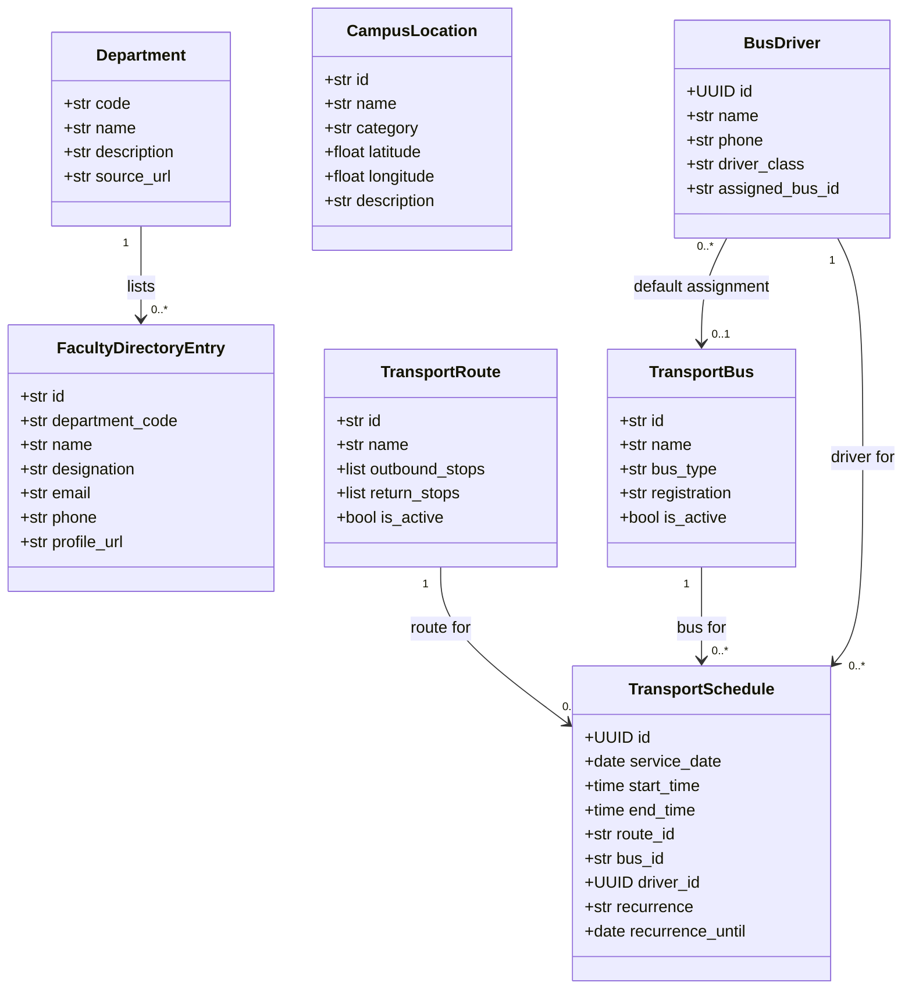
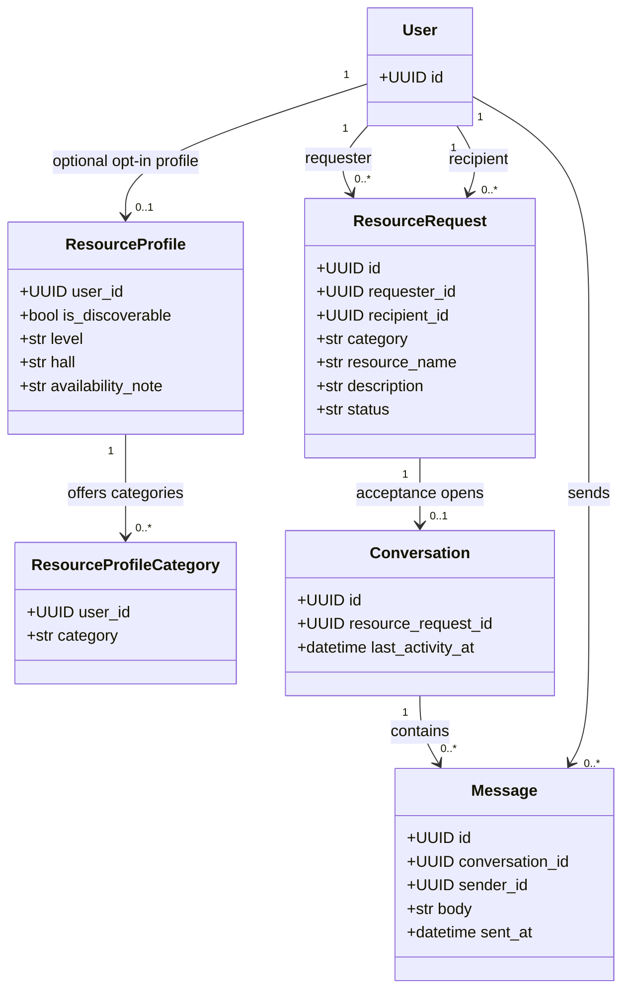
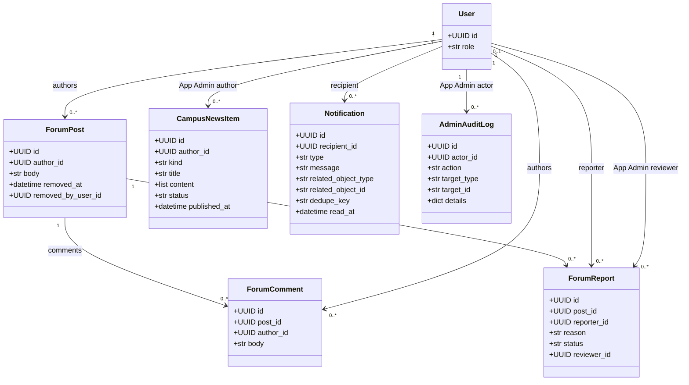
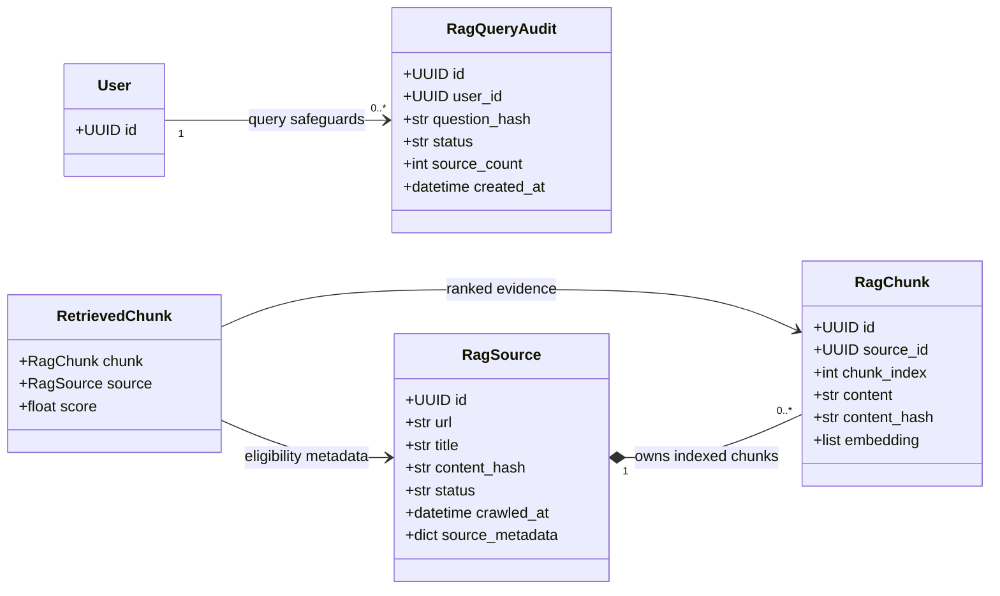
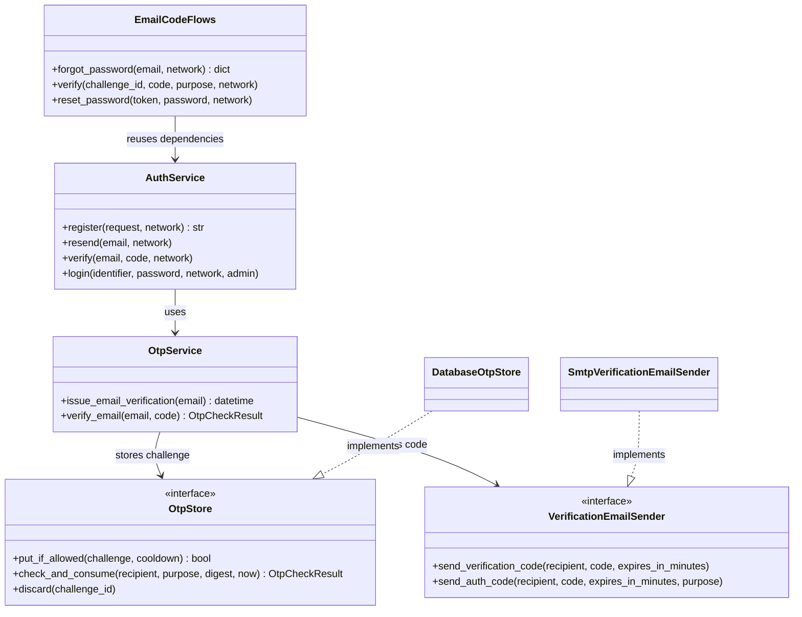
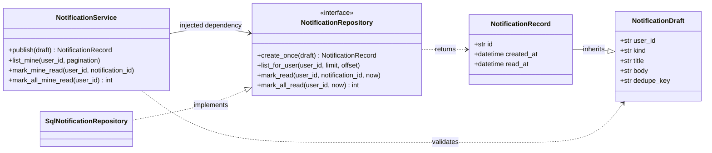
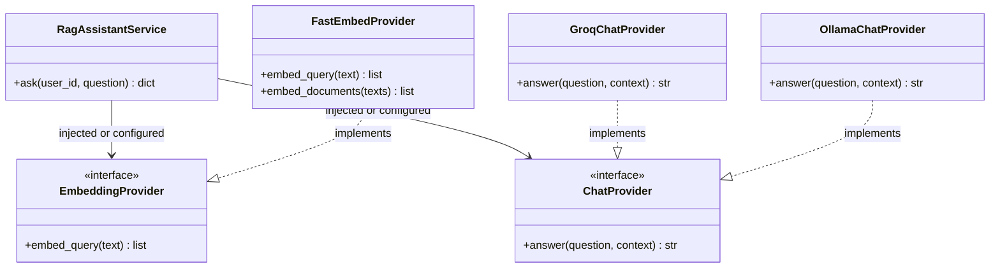

# UniCircle class diagrams

Status: implementation-aligned reference, reviewed **1 November 2026**.

These views show the principal persisted classes and selected service contracts
in the current project. They are split by feature to keep the rendered diagrams
readable. Repeated `User` and `Club` boxes refer to the same classes, not copies.
See the [ERD](ERD.md) for the relational design and the
[API design](api_desing.md) for request/response contracts.

## Notation and scope

- Attributes use Python-side names, not necessarily JSON response names. `+`
  identifies a public class member; it does not grant API access to that member.
- Associations show foreign-key or runtime dependencies. They do not imply that
  every association has a SQLAlchemy `relationship()` property.
- Quoted multiplicities describe related instances: `1`, `0..1`, and `0..*`.
  `..|>` denotes structural implementation of a Python protocol.
- ORM classes inherit `Base`; many also inherit `TimestampMixin`. Those repeated
  base classes, timestamps, indexes, validators, and some secondary fields are
  omitted. No entity CRUD methods are invented where routers own the behavior.
- Role checks and state-transition rules remain service/router responsibilities;
  not every invariant can be inferred from a class association.

## 1. Accounts, sessions, and email challenges

Source: [ORM models](../../backend/app/db/models.py),
[authentication service](../../backend/app/modules/auth/service.py), and
[email-code flows](../../backend/app/modules/auth/email_flows.py).

`student`, `teacher`, `staff`, and `admin` are values of `User.role`, not ORM
subclasses. General Users require username/email/university ID and profile fields;
App Admins instead have a provisioned `admin_id`. Nullable fields are omitted or
null as appropriate for the role. `verified_at`, `revoked_at`, and `consumed_at`
can also be null. Rate-limit buckets intentionally use digests rather than a
foreign key to an account, allowing throttling of unknown identifiers too.

Password-recovery codes and single-use grants reuse `OtpChallengeRecord` with
different purposes. There is no separate reset-token entity or refresh-token
class. Normal login is password-only; registration requires email verification.

## 2. Club ownership, recruitment, and approval

Source: [club models](../../backend/app/db/models.py) and
[club governance routes](../../backend/app/modules/clubs/router.py).

`ClubAdmin` and `ClubMember` have composite club/user keys. One student can
administer several clubs and one club can have several admins. Club-admin
appointments are restricted to active verified students, also create membership,
and must preserve a final admin. App Admin is not automatically a Club Admin.

Approval of a club-creation request creates the club and its initial admin/member
atomically. `approved_club_id` and reviewer fields are nullable while pending.
The diagram shows the FK's cardinality, not an additional database uniqueness
constraint. Membership recruitment charges the server-controlled Tk 200 fee;
submission does not itself approve membership or verify a payment.

## 3. Club events and participation

```mermaid
classDiagram
    direction LR
    class Club {
        +str id
        +str name
    }
    class User {
        +UUID id
        +str role
    }
    class ClubEvent {
        +UUID id
        +str club_id
        +str title
        +datetime starts_at
        +datetime ends_at
        +bool registration_enabled
        +datetime registration_closes_at
        +bool is_paid
        +int fee
        +str bkash_number
    }
    class EventInterest {
        +UUID event_id
        +UUID user_id
        +str status
    }
    class EventRegistration {
        +UUID id
        +UUID event_id
        +UUID user_id
        +str participant_name
        +str email
        +str student_id
        +str department_name
        +str bkash_trx_id
        +str payment_status
    }
    Club "1" --> "0..*" ClubEvent : owns
    ClubEvent "1" --> "0..*" EventInterest : interest records
    User "1" --> "0..*" EventInterest : interested or going
    ClubEvent "1" --> "0..*" EventRegistration : registrations
    User "1" --> "0..*" EventRegistration : registers
```

The event/user registration pair is unique. Interest/Going and registration are
separate records. Registration can be disabled, free, or paid; a transaction ID
is required only for paid registration. Payment review is a human-authorized
action, not an integration that confirms bKash transfers automatically.
Event status is derived from its dates, not a persisted `status` attribute.

## 4. Departments, campus places, and transport

Faculty contacts can be null. A faculty listing is not a `User` account and has
no account FK. `User.department_name` is a profile string, not a department FK.
`CampusLocation` is independent: route stops are JSON strings, not FKs to map
locations. Bus defaults and per-schedule assignments are different relationships.
Schedules are recurrence templates expanded into dated trips on reads, not a
separate persisted class for every occurrence. Map bounds/boundary come from
campus configuration rather than a `CampusMap` database class.

## 5. Resource discovery and participant-only chat

Only the recipient can accept/reject a request. Acceptance creates at most one
conversation, using the requester's and recipient's identities as participants;
there is no separate conversation-membership class. Participants alone can read
or send messages. Discovery is opt-in. Chat uses bounded REST history/polling,
not WebSockets, and does not claim end-to-end encryption.

## 6. Community, publishing, notifications, and audit

Report uniqueness is enforced per post/reporter. Moderation soft-removes a post;
reviewer/removal fields can be null. Normal news reads return published items only.
Notifications deduplicate on recipient/key. Their related-object strings, and
audit target strings, are polymorphic references rather than SQL foreign keys.

`EventNotification`, `CampusNewsNotification`, and `ClubMembershipNotification`
also remain mapped in the repository as feature-specific notification tables.
They are omitted from this principal-class view: the current shared inbox and
feature publishers use `Notification`. No implemented `Outbox` class is assumed.

## 7. RAG knowledge and query records

`RetrievedChunk` is a runtime dataclass, not a database table. Chunk embeddings
are stored as JSON numeric arrays in PostgreSQL; a dedicated vector database is
not required by this implementation. Query audits store a question hash, not a
chat transcript. Bundled Markdown/TXT knowledge is an ingestion input, not a
separate ORM entity. Source/chunk positions are unique within each source.

## 8. Implemented service and protocol boundaries

These are selected actual classes, not a claim that every feature has its own
service/repository class. Many feature routers operate directly on a SQLAlchemy
session. Protocol realization below is structural Python typing.

The embedding factory also supports LangChain's Ollama embedding adapter.
Configuration selects a chat provider and embedding provider; these alternatives
are not an automatic provider-failover chain. Ingestion needs document embeddings
as well as the query-embedding contract. Answers expose no source/citation list.

### Service source map

| Classes/contracts | Implementation |
| --- | --- |
| `AuthService`, `EmailCodeFlows` | [auth service](../../backend/app/modules/auth/service.py), [recovery flows](../../backend/app/modules/auth/email_flows.py) |
| `OtpService`, `OtpStore`, `DatabaseOtpStore` | [OTP core](../../backend/app/core/otp.py), [SQL persistence](../../backend/app/modules/auth/persistence.py) |
| Email sender protocol and implementation | [SMTP adapter](../../backend/app/core/email.py) |
| Notification service/DTOs/protocol | [notification core](../../backend/app/core/notifications.py) |
| `SqlNotificationRepository` | [SQL adapter](../../backend/app/modules/notifications/repository.py) |
| RAG service/provider contracts | [assistant service](../../backend/app/modules/assistant/service.py) |
| `FastEmbedProvider` | [embedding factory](../../backend/app/modules/assistant/embeddings.py) |

Related view: [component diagrams](Component_Diagram.md).
