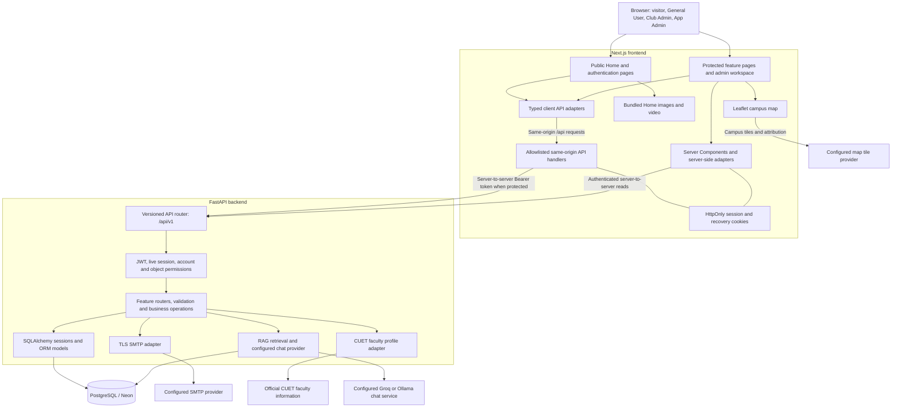
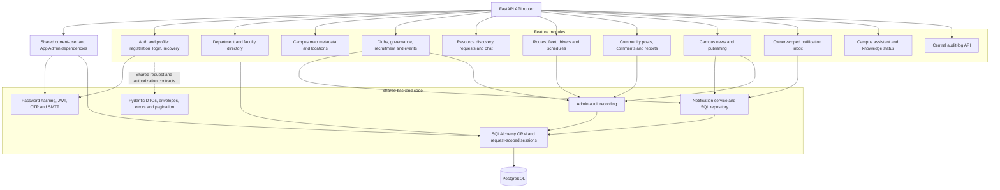
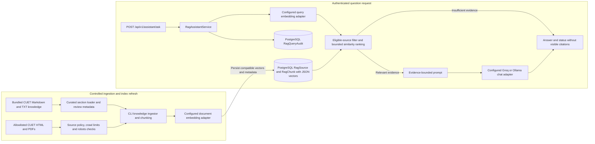
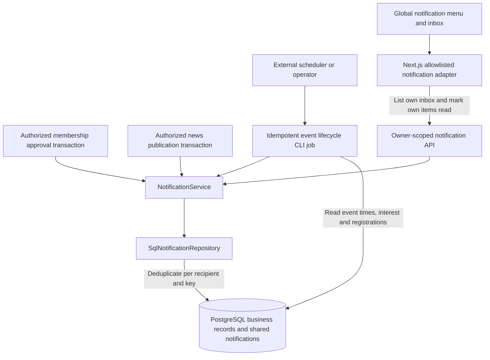

# UniCircle component diagrams

Status: implementation-aligned reference, reviewed **1 November 2026**.

These diagrams describe logical components in the current repository. Mermaid
flowcharts are used for GitHub-compatible component views; boxes denote modules,
adapters, processes, or stores, not necessarily separate deployed services.
They complement the [HLD](HLD.md), [class diagrams](Class_Diagram.md), and
[API design](api_desing.md). Older HLD/LLD proposals should not be interpreted as
proof that an outbox, WebSocket service, or dedicated vector database exists.

## 1. Application and external boundaries

- Home is frontend content. Browsers do not receive database credentials or read
  the JWT stored in the HttpOnly session cookie.
- BFF routes are explicit allowlists, not unrestricted proxies. Protected writes
  check Origin/CSRF. Public authentication calls enforce their own origin rules.
- The guards box applies to protected operations; registration, login, recovery,
  and liveness have their documented public contracts instead.
- FastAPI repeats authorization using the current account/session and object
  state. Hiding an Admin button in the UI does not secure an operation.
- The map uses CUET bounds, boundary, and saved points. Tile requests originate
  from the browser. Unavailable faculty-profile enrichment falls back to saved
  listing/contact data.
- Provider boxes represent configuration choices, not a claim about live service
  availability. Vercel services and local Compose express different deployments
  of these same logical boundaries.

Sources: [Next.js route handlers](../../frontend/src/app/api),
[typed adapters](../../frontend/src/services),
[backend router](../../backend/app/api/router.py),
[authentication dependencies](../../backend/app/core/auth.py),
[Vercel configuration](../../vercel.json), and [Compose](../../compose.yaml).

## 2. Backend feature components and shared infrastructure

The module boxes group actual Python modules, not fictitious service classes.
Several routers implement transactions directly on a request-scoped session.
The feature operation owns commit/rollback; the session dependency is not an
automatic unit-of-work commit.

The Admin frontend is a central workspace over feature-owned protected APIs:
club-request decisions live in the clubs module, transport management in
transport, publishing in news, moderation in forum, and knowledge status in the
assistant module. `modules/admin` itself currently exposes audit-log reads.

| Feature | Frontend component area | Backend module |
| --- | --- | --- |
| Login, sign-up, recovery, profile | `features/auth`, `features/profile` | `modules/auth` |
| Home and navigation | `features/home`, `features/shell` | No Home CRUD module |
| Faculty directory | `features/directory` | `modules/directory` |
| Campus explorer | `features/campus-explorer` | `modules/campus` |
| Clubs, events, recruitment | `features/clubs-events` | `modules/clubs` |
| Resource sharing and chat | `features/resources`, `features/chat` | `modules/resources` |
| Transport | `features/transport` | `modules/transport` |
| Discussion forum | `features/forum` | `modules/forum` |
| News and announcements | `features/news` | `modules/news` |
| Notifications | `features/notifications` | `modules/notifications` plus shared notification core |
| Campus assistant | `features/assistant` | `modules/assistant` |
| Main admin workspace | `features/admin` | Feature-owned admin routes plus `modules/admin` |

## 3. RAG ingestion and answering components

The curated knowledge loader uses the Markdown source; the TXT file is its
human-readable companion. Web ingestion is an alternative configured workflow,
not an automatic web search for each user question. Ingestion and queries must
use compatible embedding models and dimensions; changing the provider/model
requires a compatible rebuilt index.

The embedding factory supports a small bundled FastEmbed model or an Ollama
adapter. Chat generation separately selects Groq or Ollama. The index is bounded
PostgreSQL-backed retrieval over JSON vectors, not a standalone vector server.
Review-date/source eligibility and no-context behavior prevent unsupported
answers. Raw private chat, account secrets, and payment records are not inputs
to the knowledge pipeline. Query audit stores hashes and safeguard metadata,
not a persisted conversation history.

Sources: [curated loader](../../backend/app/modules/assistant/curated.py),
[ingestion CLI](../../backend/app/modules/assistant/ingest.py),
[embedding factory](../../backend/app/modules/assistant/embeddings.py), and
[retrieval/chat service](../../backend/app/modules/assistant/service.py).

## 4. Notifications and scheduled work

News and membership publishers write notifications inside their business
transactions. The separate event job scans due event states and commits
deduplicated notifications directly. There is no implemented outbox/queue
component in this path. A scheduler invoking the job is an operational
dependency, not evidence of a continuously running worker or a configured
production schedule. Read state belongs to the recipient.

Sources: [event lifecycle job](../../backend/app/modules/clubs/notifications.py),
[shared notification service](../../backend/app/core/notifications.py),
[SQL repository](../../backend/app/modules/notifications/repository.py), and
[inbox routes](../../backend/app/modules/notifications/router.py).

## Maintenance

Keep component boundaries aligned with actual imports, BFF allowlists, provider
factories, and deployment configuration. A design box is not permission to expose
a new endpoint or share private data. Changes to models/contracts should also
update the [class diagrams](Class_Diagram.md), [API design](api_desing.md), and
affected [sequence diagrams](Sequence_Diagram.md).
