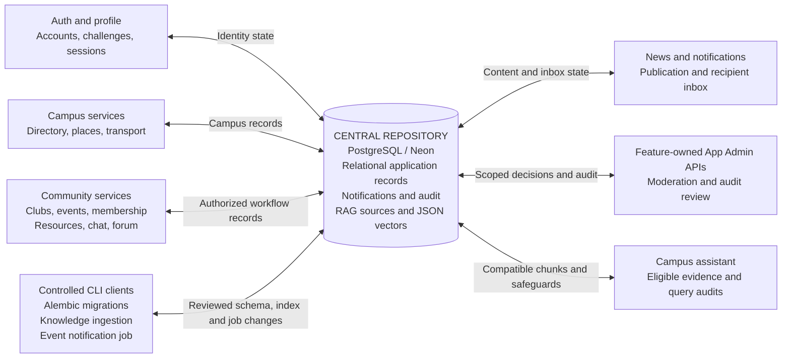

# UniCircle data-centred architectural model

Status: implementation-aligned repository architecture, reviewed
**2 November 2026**.

UniCircle uses a **shared repository model**: feature modules coordinate through
one PostgreSQL database, accessed by the FastAPI backend through SQLAlchemy.
The modules are parts of one backend, not independent microservices with their
own databases. The diagram shows data access and ownership boundaries; it is not
an entity-relationship diagram or a runtime call sequence.

All service-to-repository paths above pass through SQLAlchemy models and
operation-owned sessions. The diagram collapses that common adapter so the
shared data store remains visible at the centre. Browser → Next.js BFF → FastAPI
authentication/validation/authorization occurs before these module operations.
The arrows are bidirectional data access, not a claim that PostgreSQL initiates
API calls or automatically dispatches application events.

External providers consume bounded data supplied by backend operations; they are
not shared stores and do not connect to the database. The browser and frontend
also have no direct database access. Static Home media and the curated source
files are bundled assets. The searchable RAG index is persisted in PostgreSQL;
the vector values are JSON arrays rather than a standalone vector database.

## Logical ownership within the shared repository

These are logical groups in the same schema, not separate physical databases or
a claim of implemented PostgreSQL partitioning.

| Repository data group | Responsible modules | Access and consistency rules |
| --- | --- | --- |
| Users, profiles, verification/recovery challenges and sessions | Auth | Password hashes and OTP digests only; session revocation and current account state are checked on protected requests. Profile updates are owner-scoped. |
| Departments, faculty, map boundaries and places | Directory, campus | Authenticated read contracts; controlled import/seed data and optional faculty-profile enrichment. Saved contact data supports enrichment failure. |
| Routes, buses, drivers, schedules and assignments | Transport | General User reads; App Admin updates validate related records and write audit metadata. |
| Club proposals, clubs, admin/member mappings and recruitment requests | Clubs | App Admin approves new clubs; mapped Club Admins manage their own clubs. Membership approval and notification are committed together. |
| Events, interest and registrations | Clubs | Only the corresponding Club Admins mutate events or review registrations. Public DTOs expose permitted counts rather than other students' private registration/payment details. |
| Resource listings, requests and request-linked messages | Resources | Resource ownership and request participants determine access. Accepted request state gates chat; messages are persisted, not transported by an implemented WebSocket service. |
| Forum posts, comments, reactions and reports | Forum | Author permissions and App Admin moderation determine mutations; removal and visibility rules apply to related content. |
| News and recipient notifications | News, notification core | Publishing and associated notifications share a transaction. Inbox queries and read state are recipient-scoped, with deduplication keys for retries. |
| Sources, chunks and embeddings | Assistant | Curated corpus hash, pipeline version, provider/model compatibility and review dates gate retrieval. Alias matches cannot bypass source eligibility. |
| Query safeguards and admin audit logs | Assistant, feature-owned admin actions | Question hashes and minimal action metadata support rate limits and review. Secrets, passwords, OTP values and raw private conversation contents are excluded from these audit payloads. |

## Representative repository interactions

| Trigger | Read set | Write set / result |
| --- | --- | --- |
| Successful verified-user login | Account and credential state | Revocable session; JWT is returned to the server-side BFF for its HttpOnly cookie. |
| Approve a club proposal | Pending proposal and reviewer authorization | Club, initial member/admin mappings, reviewed proposal and admin audit entry in the approval transaction. |
| Approve membership | Locked pending request, club and current admin mapping | Member mapping, approved request and recipient notification in one transaction. |
| Publish news | Current news state and App Admin authorization | Publication state, required recipient notifications and safe audit metadata within the publishing operation. |
| Ask the assistant | Eligible compatible RAG chunks and per-user safeguard history | Minimal query audit; selected context goes to the model. Chat transcripts are not persisted by this RAG path. |
| Refresh curated knowledge | Bundled source documents, provenance and existing provider namespace | Prepare and validate all embeddings first, then atomically replace matching sources/chunks. Other application records and incompatible provider namespaces are preserved. |

## Consequences and boundaries

- **Consistency:** foreign keys, uniqueness constraints, row locking where
  implemented, and operation-owned transactions support cross-feature invariants.
  Shared sessions do not automatically commit business changes.
- **Reuse:** users, club mappings, notifications and audit identities are reused
  across features instead of copied into isolated feature databases.
- **Authorization:** access is enforced by backend dependencies and query/object
  checks. This diagram does not imply database row-level security policies or
  that all modules may read every private table.
- **Coupling:** schema changes can affect several features. Review Alembic
  migrations, contracts and tests together; a code rollback does not roll back
  data or migrations automatically.
- **Availability:** database outages affect many features. Backups, recovery,
  connection limits and dependency monitoring are operational responsibilities.
  A successful `/health` response is not proof that the knowledge index is ready.
- **Notification delivery:** news and membership actions write notifications
  directly in their transaction; the event lifecycle job writes them directly
  when invoked. There is no implemented outbox, message broker or autonomous
  blackboard inference engine in this model.

Sources: [ORM models](../../backend/app/db/models.py),
[session lifecycle](../../backend/app/db/session.py),
[club transactions](../../backend/app/modules/clubs/router.py),
[news operations](../../backend/app/modules/news),
[notification repository](../../backend/app/modules/notifications/repository.py),
[curated ingestion](../../backend/app/modules/assistant/curated.py), and
[component diagrams](Component_Diagram.md).
