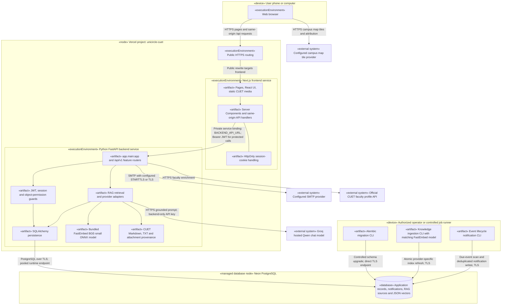

# UniCircle UML deployment diagram

Status: implementation-aligned deployment reference, reviewed **2 November 2026**.

This view represents the configured Vercel/Neon deployment. Mermaid subgraphs
represent UML nodes and execution environments; nested rectangles represent
deployed artifacts. Stereotypes and labelled communication paths distinguish
devices, runtimes, artifacts, external systems, and operator-run jobs. These are
logical deployment boundaries, not claims about a provider's physical machines
or a permanently running server process.

## Deployment rules and artifact placement

| Node / artifact | Deployment responsibility |
| --- | --- |
| User device | Browser runs the UI; it does not connect to PostgreSQL or read provider credentials. Static Home content is public; feature pages require authentication. |
| Vercel frontend service | Builds `frontend/`; handles public pages, guarded pages, cookies, same-origin handlers, and server-side API calls. The canonical production origin is `https://unicircle-cuet.vercel.app`. |
| Vercel backend service | Builds `backend/`; runs `app.main:app`. Root routing exposes the frontend; the backend is reached through the generated service binding. Protected APIs repeat authorization. |
| Embedding artifacts | The backend build runs `python -m app.modules.assistant.prepare_model`. Request-time FastEmbed loads bundled weights without an Ollama laptop dependency or a model download. |
| Neon database | Shared persistent application store. Runtime uses the pooled TLS connection. Reviewed schema migrations and controlled indexing use the intended branch and suitable direct connection. |
| External providers | SMTP delivers account codes; Groq generates grounded answers. Browser map tiles and optional CUET faculty enrichment are independent outbound integrations. |
| Operator/job runner | Runs migrations, knowledge refresh, and event-notification commands explicitly. This diagram does not assert that a production cron schedule or persistent worker is configured. |

The backend service configuration permits up to 300 seconds per function and
includes bundled embedding files. It does not make ingestion a startup hook or a
user-request task. There is no separate deployed vector server, Redis broker,
WebSocket service, or Ollama node in this cloud topology. Credentials live in
Vercel runtime secrets or ignored operator environment files, never in these
artifacts or browser-visible variables.

## Build, release, and index consistency

1. A reviewed `main` revision runs GitHub Actions CI. Vercel builds both service
   artifacts; the required CI gate controls production domain assignment.
2. Apply any reviewed database migration through the controlled release process.
   Migrations do not run at function startup.
3. When the corpus or pipeline changes, explicitly rebuild the Neon index with
   the same embedding provider/model and corpus as the release. Pipeline version
   2 includes attachment provenance and exact retrieval aliases. A code push
   alone does not perform this data operation.
4. Verify knowledge readiness and a grounded answer before completing an index
   change. Atomic refresh preserves stored data on embedding failure, but the
   strict corpus/version gate can temporarily reject mismatched revisions.
5. CD smoke checks test the released commit's public origin and backend liveness.
   Liveness alone does not establish knowledge readiness, SMTP delivery, or every
   authenticated user workflow. Roll back code and index compatibly if required.

## Alternative local container topology

The local [Compose configuration](../../compose.yaml) is a separate deployment:
`frontend` calls `backend:8000` on the `app` network; `backend` and the one-shot
`migrate` service reach PostgreSQL on the internal `database` network. The database
uses the named `postgres_data` volume. Host bindings are loopback-only by default
for frontend port 3000 and database port 55432; backend port 8000 is not published.
The [production overlay](../../compose.production.yaml) removes the database host
binding and requires reviewed image tags. This does not deploy containers into
the Vercel service runtimes. Ollama remains an optional separately configured
local provider, not a service supplied by this Compose file.

Sources: [Vercel service configuration](../../vercel.json),
[deployment runbook](../deployment/README.md),
[CD runbook](../deployment/CD.md),
[CI workflow](../../.github/workflows/ci.yml),
[CD smoke workflow](../../.github/workflows/cd.yml),
[model preparation](../../backend/app/modules/assistant/prepare_model.py), and
[embedding adapter](../../backend/app/modules/assistant/embeddings.py).
